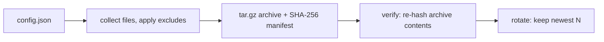

# backup-automation

[](https://github.com/AJJudkins/backup-automation/actions/workflows/ci.yml)

A small Python backup tool that creates timestamped `.tar.gz` archives, writes a SHA-256 manifest, **verifies** each backup by re-reading it, and **rotates** old backups. Supports a JSON config file and a `--dry-run` mode.

## Problem
Backups are only useful if they run consistently, are checked, and do not fill the disk. This automates all three for local directories.

## How it works


## Setup
```bash
python3 -m venv .venv && source .venv/bin/activate
pip install pytest
pytest          # tests run entirely in temporary directories
```
Standard library only; no rsync is required (the tool uses Python's `tarfile`).

## Usage
Edit `config.example.json` (or copy it):
```json
{ "sources": ["./sample_source"], "destination": "./backups", "keep": 3, "exclude": ["*.tmp", "__pycache__"] }
```
```bash
python backup.py --config config.example.json --dry-run   # preview only
python backup.py --config config.example.json             # real run
```

## Sample output
```
Created backups/backup-20261018-150000.tar.gz
  + sample_source/notes.txt
Verification: OK
```
Dry run prints `[DRY RUN] would create ...` and changes nothing.

## Limitations
- Full backups only (no incremental/differential), local destinations only (no remote sync or encryption).
- Rotation deletes files in the destination folder matching `backup-*.tar.gz`, so point it at a dedicated folder. Try `--dry-run` first.

## What it demonstrates
Automation scripting, data-integrity checks with hashing, retention policies, safe dry-run design, and tests using temporary directories.

## Hardening notes
- The config is validated (sources must exist, `keep` must be an integer >= 1, the destination may not be inside a source) and errors exit with code 2 and a clear message.
- Rotation only deletes files named exactly like `backup-YYYYMMDD-HHMMSS.tar.gz` (plus their manifests) in the destination; use `--no-rotate` to never delete, `--dry-run` to preview.
- Archives are created owner-only (`0600`) because backups often contain private data.
- Install the console script with `pip install -e .` (then `backup-automation --config my.json --dry-run`).

## Security and testing status

- **Safety:** writes only inside the configured destination; deletes only rotated archives that match the strict backup filename pattern; `--dry-run` and `--no-rotate` available; archives are `0600`; the destination cannot be inside a source.
- **Tested:** archive creation, verification, exclusion, rotation, validation and CLI errors in temporary directories on Linux.
- **Not tested:** large backups, network or removable destinations, symlink-heavy trees, Windows/macOS, and restoring from a backup (restore is not implemented).
- See [SECURITY.md](SECURITY.md).

## License
MIT
